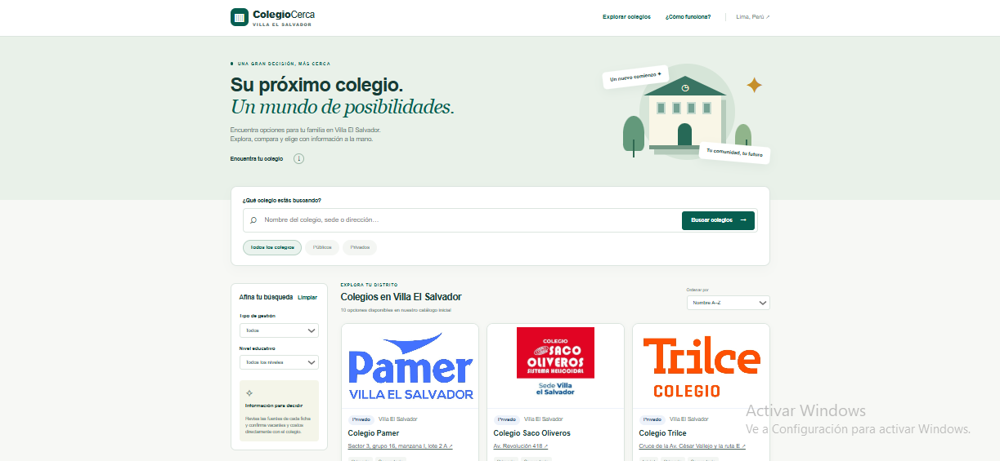

# Colegio Cerca · Villa El Salvador

**Encuentra colegios públicos y privados de Villa El Salvador.**  
Explora diez sedes, filtra por gestión y nivel, y abre cada ficha para consultar su ubicación, contacto y fuentes.

**[🌐 Explorar el directorio](https://colegio-cerca-ves.onrender.com/)** &nbsp; · &nbsp; [Ver código de la entrega](https://github.com/CAMILABERROCAL/PixelVault-JSON/tree/entrega/colegio-cerca) &nbsp; · &nbsp; [Guía para la demostración](https://github.com/CAMILABERROCAL/PixelVault-JSON/blob/52c97c1e677060519cd5ba55f75f2893a33f0835/README.md)

## Del catálogo de libros al directorio de colegios

En el curso Herramientas de Desarrollo partimos de AulaLibro y conservamos su historial en Git. En Colegio Cerca, una familia puede buscar una sede, elegir, por ejemplo, **gestión privada** y **nivel secundaria**, y abrir una ficha para consultar la dirección en Maps. Los datos y las fotos se distribuyen con la web. [Explorar los archivos del directorio](https://github.com/CAMILABERROCAL/PixelVault-JSON/tree/52c97c1e677060519cd5ba55f75f2893a33f0835/web)

## Quién hizo qué

Abre el nombre de cada integrante para ver su aporte y la evidencia en GitHub.

<strong>Camila Andrea Berrocal Reyes · Directorio y publicación en Render</strong>

Creó el directorio, incorporó diez fichas y ajustó las tarjetas para mostrar los logos, teléfonos y enlaces a Maps. En la ficha de Pamer se puede seguir el recorrido completo desde el catálogo hasta los datos de contacto. Publicó el sitio en Render y dejó su dirección pública en el README.

[Primer directorio](https://github.com/CAMILABERROCAL/PixelVault-JSON/commit/8980bfe) · [Mejora de las tarjetas](https://github.com/CAMILABERROCAL/PixelVault-JSON/commit/e2c8a74) · [Visitar la web](https://colegio-cerca-ves.onrender.com/)

<strong>Alexander Cuzcano · Docker, Nginx y Compose</strong>

Preparó `Dockerfile.web` para copiar la carpeta `web/` a Nginx. Añadió a Compose el servicio que permite abrir el directorio en el puerto local 8082, documentó los comandos y registró la ejecución con capturas.

[Configuración Docker · PR 30](https://github.com/CAMILABERROCAL/PixelVault-JSON/pull/30) · [Guía · PR 31](https://github.com/CAMILABERROCAL/PixelVault-JSON/pull/31) · [Capturas · PR 32](https://github.com/CAMILABERROCAL/PixelVault-JSON/pull/32)

<strong>Jhair · Pruebas y GitHub Actions</strong>

Implementó seis workflows y pruebas para el catálogo, las fichas y los filtros. Durante la integración se actualizaron los casos que todavía esperaban precios. La versión presentada pasó las 31 pruebas del directorio.

[Aporte de Jhair](https://github.com/CAMILABERROCAL/PixelVault-JSON/commit/ed193c2) · [Ver los workflows](https://github.com/CAMILABERROCAL/PixelVault-JSON/tree/52c97c1e677060519cd5ba55f75f2893a33f0835/.github/workflows)

<strong>Diego · Base del despliegue en Kubernetes</strong>

Preparó el Deployment, el Service y la guía de Kubernetes de la aplicación anterior. Para la entrega de Colegio Cerca, la integración adaptó la imagen a Nginx, el puerto a 80 y las comprobaciones de salud a la portada y al catálogo JSON.

[Propuesta de Diego · PR 29](https://github.com/CAMILABERROCAL/PixelVault-JSON/pull/29) · [Manifiesto utilizado en la exposición](https://github.com/CAMILABERROCAL/PixelVault-JSON/blob/52c97c1e677060519cd5ba55f75f2893a33f0835/k8s/colegio-cerca.yaml)

<strong>Stiven · Documentación y trabajo con Git</strong>

Organizó el README de AulaLibro y documentó el flujo de trabajo con Git usando un pull request del equipo como ejemplo. Esa estructura sirvió de base para la guía de Colegio Cerca con las instrucciones de despliegue y demostración.

[Borrador · PR 33](https://github.com/CAMILABERROCAL/PixelVault-JSON/pull/33) · [Documentación de Git · PR 34](https://github.com/CAMILABERROCAL/PixelVault-JSON/pull/34) · [Guía integrada](https://github.com/CAMILABERROCAL/PixelVault-JSON/blob/52c97c1e677060519cd5ba55f75f2893a33f0835/README.md)

## Herramientas del proyecto

| Etapa | Tecnologías | Cómo las usamos |
|---|---|---|
| **Edición e historial** |    | IntelliJ IDEA para editar el sitio, Git para registrar cambios y GitHub para revisar los aportes por rama. |
| **Interfaz** |    | HTML organiza las fichas, CSS adapta las tarjetas a la pantalla y JavaScript aplica los filtros al catálogo JSON. |
| **Pruebas** |   | Node.js ejecuta las pruebas. GitHub Actions comprueba filtros, fichas, catálogo, estructura HTML, sintaxis y respuesta HTTP. |
| **Despliegue local** |    | Docker empaqueta la web con Nginx. Kubernetes en Docker Desktop mantiene una réplica y la conecta con un Service. |
| **Publicación web** |  | Render publica la carpeta estática del directorio y permite acceder desde otro dispositivo. |

## Cómo ver el despliegue

- **En internet.** Abre [Colegio Cerca en Render](https://colegio-cerca-ves.onrender.com/), selecciona un nivel educativo y consulta la ficha de una sede.
- **En la laptop.** Con Docker Desktop y Kubernetes activos, ejecuta `PRESENTAR.cmd` desde la carpeta de la versión de entrega. Verás el Pod y el Service en la terminal. Déjala abierta y entra en `http://localhost:8083`. [Abrir la guía paso a paso](https://github.com/CAMILABERROCAL/PixelVault-JSON/blob/52c97c1e677060519cd5ba55f75f2893a33f0835/README.md)
