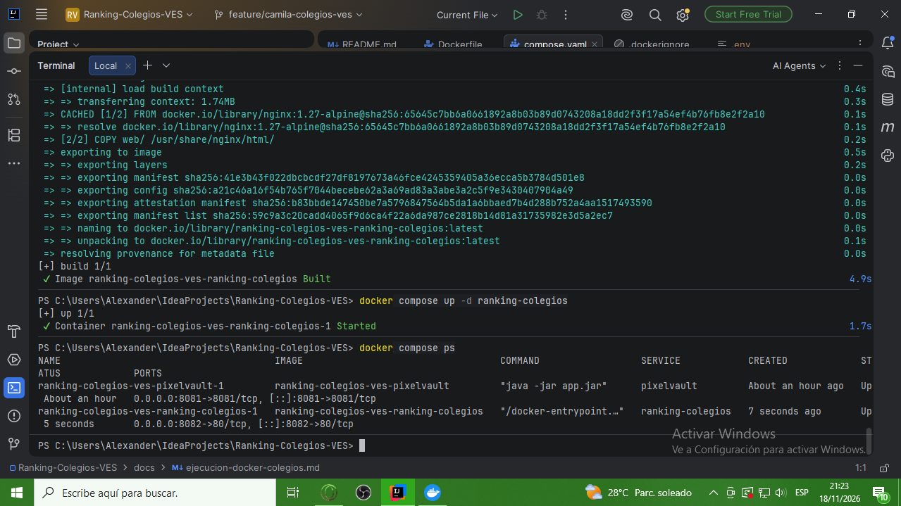

# Ejecución del ranking de colegios con Docker

## 1. Objetivo

En esta parte del proyecto se utilizó Docker para ejecutar la página web del ranking de colegios de Villa El Salvador sin necesidad de instalar un servidor web manualmente.

La finalidad es facilitar la ejecución del frontend y permitir que otros integrantes del equipo puedan utilizar la misma configuración.

## 2. Archivos utilizados

### Dockerfile.web

Este archivo permite construir una imagen Docker utilizando Nginx como servidor web.

Nginx se encarga de mostrar los archivos HTML, CSS, JavaScript y JSON del ranking de colegios.

### compose.yaml

Este archivo permite administrar los servicios Docker del proyecto.

Se agregó el servicio `ranking-colegios`, que ejecuta el frontend y utiliza el puerto 8082 de nuestra computadora.

También se mantiene el servicio `pixelvault` del proyecto anterior.

### .dockerignore

Este archivo permite excluir archivos innecesarios del contexto de construcción de Docker, como archivos temporales, configuraciones del editor y credenciales.

## 3. Comandos utilizados

### Validar la configuración

```powershell
docker compose config --quiet
```

Este comando comprueba que la configuración de Docker Compose sea válida.

### Construir las imágenes

```powershell
docker compose build
```

Permite construir las imágenes Docker utilizando los archivos de configuración del proyecto.

### Iniciar el ranking

```powershell
docker compose up -d ranking-colegios
```

Inicia el servicio del ranking de colegios en segundo plano.

### Comprobar los contenedores

```powershell
docker compose ps
```

Muestra los contenedores y permite comprobar si se encuentran en ejecución.

## 4. Resultado obtenido

Se logró construir y ejecutar correctamente el contenedor del ranking de colegios.

La página web se visualizó desde el navegador mediante la dirección:

http://localhost:8082

Se comprobó que la página mostraba las tarjetas de colegios y las opciones de búsqueda y filtrado.

## Evidencias de la ejecución del equipo




Para desplegar esta misma web en Kubernetes, sigue el [borrador de entrega](../README.md).
